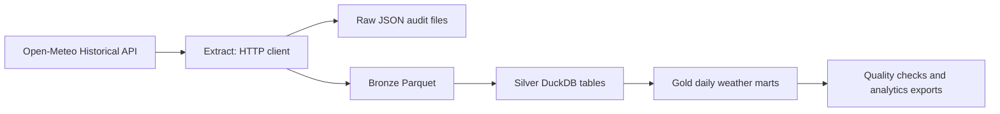

# Data Pipeline: Real-Time Weather Lakehouse

An end-to-end data engineering project that ingests real public weather data from
[Open-Meteo](https://open-meteo.com/), lands immutable raw data as Parquet,
models analytics tables in DuckDB, and enforces data quality checks.

The pipeline demonstrates:

- Public API ingestion with retries, typed configuration, and idempotent outputs.
- Data lake zones: `raw`, `bronze`, `silver`, and `gold`.
- Columnar storage with Parquet and an analytical warehouse with DuckDB.
- Dimensional modeling: locations, hourly facts, daily marts, and anomaly metrics.
- Data quality gates for uniqueness, ranges, nulls, and row-count contracts.
- Reproducible orchestration through a Python CLI, Makefile, Docker, and CI.

## Architecture



## Quick Start

```bash
python -m venv .venv
source .venv/bin/activate  # Windows: .venv\Scripts\activate
pip install -e ".[dev]"
python -m data_pipeline run --days 14
python -m data_pipeline quality
```

The default run fetches hourly weather observations for Kigali, Nairobi, Lagos,
Cape Town, and Accra.

## Useful Commands

```bash
make install
make run
make quality
make test
make clean
```

## Outputs

Generated data is intentionally ignored by Git:

- `data/raw`: JSON API responses for auditability.
- `data/bronze`: source-shaped Parquet.
- `data/warehouse/weather.duckdb`: analytical warehouse.
- `data/exports`: CSV extracts for dashboards and review.

## Optional Services

The included `docker-compose.yml` starts common data-system building blocks:

- MinIO for S3-compatible object storage.
- PostgreSQL for metadata or serving use cases.
- Adminer for database inspection.

```bash
docker compose up -d
```

The Python pipeline runs locally without these services so reviewers can test it
quickly, while the compose file demonstrates how the same project can be lifted
into a fuller data platform.

## Data Source

Open-Meteo provides free weather APIs with no API key required and historical
weather data from 1940 onward. This project uses the historical archive endpoint
for hourly temperature, precipitation, wind speed, and humidity.

## Repository Layout

```text
src/data_pipeline/       Pipeline package
sql/                     Warehouse transformation SQL
tests/                   Unit tests
docs/architecture.md     Data-system design notes
.github/workflows/ci.yml CI checks
```

