# Data catalog

Generated by `weather-pipeline catalog` from `catalog/catalog.yml`, the SQL in `sql/`
and the live warehouse schema. Do not edit by hand.

- **Owner:** Daniel Kwizera (data engineering)
- **Source system:** Open-Meteo Historical Weather API (archive-api.open-meteo.com)
- **Refresh:** On demand via `weather-pipeline run`; each run rebuilds silver and gold.

## Lineage

```mermaid
flowchart LR
    bronze_open_meteo_hourly__Parquet_["bronze.open_meteo_hourly (Parquet)"]
    silver_bronze_hourly_weather["silver.bronze_hourly_weather"]
    silver_dim_location["silver.dim_location"]
    silver_fact_hourly_weather["silver.fact_hourly_weather"]
    gold_mart_daily_weather["gold.mart_daily_weather"]
    gold_mart_city_anomalies["gold.mart_city_anomalies"]
    bronze_open_meteo_hourly__Parquet_ --> silver_bronze_hourly_weather
    silver_bronze_hourly_weather --> silver_dim_location
    silver_bronze_hourly_weather --> silver_fact_hourly_weather
    silver_dim_location --> silver_fact_hourly_weather
    silver_fact_hourly_weather --> gold_mart_daily_weather
    gold_mart_daily_weather --> gold_mart_city_anomalies
```

## Tables

### `silver.bronze_hourly_weather`

View over all bronze Parquet files. Kept as a view so silver always reads the latest landed data.

- **Layer:** silver
- **Grain:** One row per city, observation hour and ingestion run (duplicates possible).
- **Built from:** `bronze.open_meteo_hourly (Parquet)`

| Column | Type | Description |
| --- | --- | --- |
| `city` | VARCHAR | City name as configured in the pipeline. |
| `country` | VARCHAR | Country of the city. |
| `latitude` | DOUBLE | Latitude in decimal degrees (WGS84). |
| `longitude` | DOUBLE | Longitude in decimal degrees (WGS84). |
| `observed_at` | TIMESTAMP | Local observation hour. |
| `temperature_c` | DOUBLE | Air temperature at 2 m |
| `relative_humidity_pct` | BIGINT | Relative humidity at 2 m |
| `precipitation_mm` | DOUBLE | Total precipitation in the hour |
| `wind_speed_kmh` | DOUBLE | Wind speed at 10 m |
| `source` | VARCHAR | Source system identifier. Always open_meteo. |
| `ingested_at_utc` | TIMESTAMP WITH TIME ZONE | When the pipeline ingested the row (UTC). |
| `start_date` | DATE | First day of the ingestion window |
| `end_date` | DATE | Last day of the ingestion window |

### `silver.dim_location`

One row per city with a surrogate key, shared by facts and marts.

- **Layer:** silver
- **Grain:** One row per city and country.
- **Built from:** `silver.bronze_hourly_weather`

| Column | Type | Description |
| --- | --- | --- |
| `location_id` | BIGINT | Surrogate key |
| `city` | VARCHAR | City name. |
| `country` | VARCHAR | Country name. |
| `latitude` | DOUBLE | Latitude in decimal degrees. |
| `longitude` | DOUBLE | Longitude in decimal degrees. |

### `silver.fact_hourly_weather`

Typed, deduplicated hourly observations. When an hour was ingested twice, the latest ingestion wins.

- **Layer:** silver
- **Grain:** One row per city and observation hour.
- **Built from:** `silver.bronze_hourly_weather`, `silver.dim_location`
- **Quality checks:** `hourly_fact_has_rows`, `hourly_fact_unique_city_timestamp`, `temperature_reasonable_range`, `humidity_reasonable_range`, `precipitation_non_negative`

| Column | Type | Description |
| --- | --- | --- |
| `location_id` | BIGINT | Foreign key to silver.dim_location. |
| `city` | VARCHAR | City name. |
| `country` | VARCHAR | Country name. |
| `observed_at` | TIMESTAMP | Local observation hour. |
| `temperature_c` | DOUBLE | Air temperature at 2 m |
| `relative_humidity_pct` | DOUBLE | Relative humidity |
| `precipitation_mm` | DOUBLE | Hourly precipitation |
| `wind_speed_kmh` | DOUBLE | Wind speed at 10 m |
| `source` | VARCHAR | Source system identifier. |
| `ingested_at_utc` | TIMESTAMP | Ingestion time of the winning row (UTC). |

### `gold.mart_daily_weather`

Daily weather summary per city for dashboards and the PostgreSQL serving layer.

- **Layer:** gold
- **Grain:** One row per city and observation date.
- **Built from:** `silver.fact_hourly_weather`

| Column | Type | Description |
| --- | --- | --- |
| `location_id` | BIGINT | Foreign key to silver.dim_location. |
| `city` | VARCHAR | City name. |
| `country` | VARCHAR | Country name. |
| `observation_date` | DATE | Local calendar date. |
| `avg_temperature_c` | DOUBLE | Mean of hourly temperatures |
| `min_temperature_c` | DOUBLE | Lowest hourly temperature |
| `max_temperature_c` | DOUBLE | Highest hourly temperature |
| `avg_relative_humidity_pct` | DOUBLE | Mean hourly relative humidity |
| `total_precipitation_mm` | DOUBLE | Sum of hourly precipitation |
| `avg_wind_speed_kmh` | DOUBLE | Mean hourly wind speed |
| `hourly_observations` | BIGINT | Number of hourly rows behind the day. 24 means a complete day. |

### `gold.mart_city_anomalies`

Daily temperature and rainfall anomalies against each city's baseline for the loaded window.

- **Layer:** gold
- **Grain:** One row per city and observation date.
- **Built from:** `gold.mart_daily_weather`

| Column | Type | Description |
| --- | --- | --- |
| `city` | VARCHAR | City name. |
| `country` | VARCHAR | Country name. |
| `observation_date` | DATE | Local calendar date. |
| `avg_temperature_c` | DOUBLE | Daily mean temperature |
| `temperature_anomaly_c` | DOUBLE | Daily mean temperature minus the city baseline |
| `total_precipitation_mm` | DOUBLE | Daily precipitation |
| `precipitation_anomaly_mm` | DOUBLE | Daily precipitation minus the city baseline |

### `ops.dq_results`

History of data quality check results, one row per check per run. Used to monitor quality over time.

- **Layer:** ops
- **Grain:** One row per run and check.

| Column | Type | Description |
| --- | --- | --- |
| `run_id` | VARCHAR | Identifier of the quality run (UTC timestamp). |
| `check_name` | VARCHAR | Name of the quality check. |
| `passed` | BOOLEAN | Whether the check met its expectation. |
| `observed_value` | DOUBLE | Value the check measured. |
| `expectation` | VARCHAR | Rule the value had to meet |
| `checked_at_utc` | TIMESTAMP | When the check ran (UTC). |

## Business glossary

| Term | Definition |
| --- | --- |
| anomaly | The difference between a day's value and the city baseline. Positive means above normal. |
| baseline | The average of a measure for a city over all days in the loaded window. Anomalies are measured against it. |
| bronze layer | Source-shaped data stored as Parquet, plus ingestion metadata. Never edited. |
| gold layer | Business-ready aggregates (marts) that dashboards and APIs read. |
| grain | What one row of a table represents. Two rows must never describe the same grain. |
| observation | One hourly weather reading for one city. |
| silver layer | Typed, deduplicated tables with conformed dimensions. |
